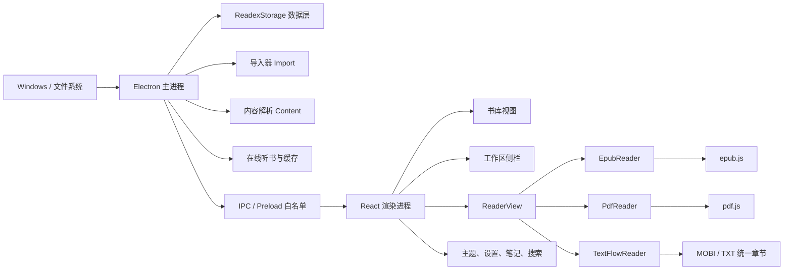
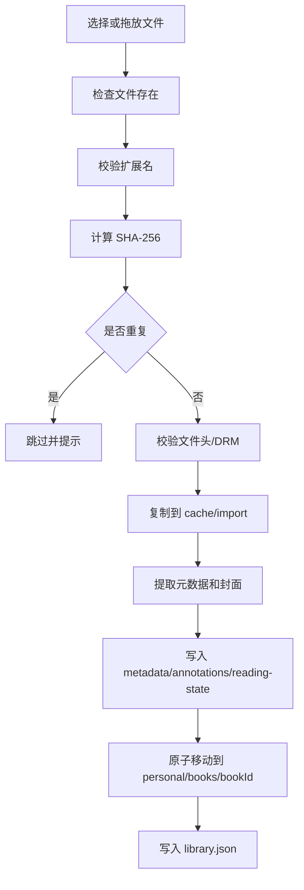

# Readex 技术设计与实现说明

> - 项目：Readex 本地电子书阅读器
> - 作者：Xiaoyao.Hao
> - 当前版本：0.1.0
> - 文档日期：2026-09-14
> - 目标平台：Windows 10/11 x64

本文档是 Readex 当前阶段的完整设计、内部逻辑、实现约束、性能优化、测试和发布说明，用于代码维护、功能扩展、故障排查和后续接续开发。

---

## 1. 文档目标

本文档回答以下问题：

1. Readex 是什么，当前已经实现哪些能力，明确不支持哪些能力。
2. 应用采用什么技术架构，为什么选择 Electron 和 React。
3. 主进程、preload、渲染进程之间如何通信。
4. 图书、笔记、设置和进度如何存储，为什么这样设计。
5. EPUB、MOBI/KF8、PDF、TXT 如何导入、解析、显示和定位。
6. 高亮、笔记、书签和 Markdown 导出如何工作。
7. 主题、字体、阅读宽度和精细滚动如何联动。
8. 为什么使用便携数据目录，如何执行备份和清空。
9. 当前做了哪些启动与包体积优化，优化边界是什么。
10. 如何测试、构建 Portable EXE、绿色 ZIP 和分享 ZIP。
11. 已知问题、回归原因和后续可继续优化的方向。

---

## 2. 产品定位

Readex 是一套面向个人用户的本地电子书阅读器，强调：

- 本地优先
- 核心阅读功能离线可用；在线听书为可选的联网能力
- 一键导入
- 多书工作区
- 接近 Codex 桌面端的紧凑界面
- 阅读、标记、笔记和书签一体化
- Windows 绿色版和便携数据迁移
- 不依赖账号、云服务和服务器

### 2.1 目标用户

- 希望把电子书集中保存在本机并离线阅读的用户
- 需要 EPUB、MOBI、PDF、TXT 统一阅读入口的用户
- 希望在阅读中高亮、写笔记、添加书签并导出的用户
- 希望绿色版可直接复制、发送和迁移的用户

### 2.2 当前范围内

- 无 DRM 的 EPUB
- 无 DRM 的 MOBI/KF8
- 文本型 PDF
- UTF-8、UTF-16、GB18030、Big5 等常见编码 TXT
- 本地书库
- 多书工作区
- 阅读进度恢复
- 四色高亮
- 笔记和书签
- Markdown 导出
- 当前书搜索
- 全局笔记搜索
- 应用级主题
- 精细滚动
- 按句自动滚动与可配置标注色
- 个人资料备份和安全清空
- Windows 便携版打包

### 2.3 明确不在当前范围

- DRM 解密或绕过
- 扫描 PDF OCR
- AZW、AZW3 扩展名单独支持
- 云同步和账号
- 多设备进度同步
- 在线书店或书城
- 自动更新
- 阅读统计
- 系统离线朗读
- 跨书全文索引

---

## 3. 设计原则

### 3.1 本地优先

图书原件会被复制到个人资料库。阅读、笔记、进度和设置都可以脱离网络使用。打包版本会阻止应用窗口发出 HTTP、HTTPS、WebSocket 请求。

### 3.2 可迁移

个人资料集中在 `data/personal`。迁移时将整个目录或整个绿色版应用目录复制到新位置即可。

### 3.3 不静默破坏数据

- 导入失败时不留下残缺书籍。
- JSON 使用原子替换。
- 导入前使用 SHA-256 去重。
- 清空个人资料前提供备份入口。
- 原始导入文件永远不会被删除。

### 3.4 统一阅读模型

不同格式有不同解析引擎，但上层统一使用：

- `BookRecord`
- `ReadingLocator`
- `Annotation`
- `ReaderSettings`
- `ReaderHandle`

这样可以让笔记、书签、搜索和进度共享一套交互层。

### 3.5 渐进式性能

首屏不加载阅读器大模块。EPUB.js、PDF.js、MOBI 解析器和导入器按需加载，优先缩短主窗口出现时间。

### 3.6 UI 克制但具有品牌感

界面借鉴 Codex 的紧凑布局、左侧工作区、深色壳层和状态胶囊，但使用 Readex 自有名称、Logo、主题和交互。

---

## 4. 技术栈

| 层级 | 技术 | 用途 |
| --- | --- | --- |
| 桌面运行时 | Electron 44.x | 窗口、文件系统、系统菜单、打包 |
| 构建工具 | electron-vite | 主进程、preload、渲染进程构建 |
| UI | React 19 | 组件化界面和状态管理 |
| 类型 | TypeScript | 共享类型和编译检查 |
| 图标 | lucide-react | 工具栏、菜单和状态图标 |
| EPUB | epub.js | EPUB 解析、章节、CFI 和渲染 |
| PDF | pdfjs-dist | Canvas 渲染、文本层、搜索 |
| MOBI/KF8 | @lingo-reader/mobi-parser | MOBI/KF8 元数据和章节解析 |
| 听书 | node-edge-tts | Microsoft Edge 在线语音、MP3 和词级时间戳 |
| TXT 编码 | chardet、iconv-lite | 编码识别和中文编码转换 |
| EPUB/导入 | JSZip、fast-xml-parser | ZIP、OPF、容器和元数据解析 |
| HTML 清理 | DOMPurify | 清理 MOBI/TXT 生成内容 |
| 打包 | electron-builder | Portable EXE、ZIP、解压目录 |
| 测试 | Vitest | 主进程工具、主题、目录、滚动和笔记测试 |

---

## 5. 总体架构



### 5.1 进程职责

#### 主进程

- 创建和管理窗口
- 处理便携数据路径
- 文件选择、保存、打开目录
- 导入和解析图书
- 通过 `readex://` 自定义协议流式提供书籍文件
- 读取、保存和删除本地数据
- 后台维护注解搜索索引，界面按需加载当前书注解
- 备份和清空个人资料
- 协调阅读快捷键和窗口级操作
- 控制原生窗口与标题栏主题
- 拦截打包环境网络请求

#### preload

- 通过 `contextBridge` 暴露 `window.readex`
- 只暴露白名单方法
- 不暴露 `ipcRenderer`、`fs`、`path` 等底层对象

#### 渲染进程

- 所有 UI 和阅读交互
- 维护 React 状态
- 调用 `window.readex` 完成数据操作
- 不直接访问文件系统

### 5.2 安全配置

`BrowserWindow` 使用：

```ts
contextIsolation: true
nodeIntegration: false
sandbox: true
webSecurity: true
```

渲染进程只通过 preload 白名单 API 访问能力。

打包环境额外执行：

- 使用 sandbox 兼容的 CommonJS preload，并验证 `window.readex` 注入
- 监听 `render-process-gone`，自动重载页面，连续失败后显示恢复页
- 图书文件通过支持 HTTP Range 的 `readex://book/<id>/source.<format>` 提供
- 阻止 `http://`、`https://`、`ws://`、`wss://` 请求
- 禁止窗口打开新页面
- 阻止导航到允许范围之外的 URL
- EPUB iframe 禁止脚本内容
- MOBI/TXT HTML 经过 DOMPurify 清理

---

## 6. 工程目录

```text
Readex/
  build/
    readex.ico                Windows 透明多尺寸图标
    readex.png                application、任务栏和界面 logo 图标源
  packaging/
    使用说明.txt              分享包用户说明
  patches/
    @lingo-reader__mobi-parser@0.4.6.patch
  src/
    main/
      index.ts                主进程、窗口、IPC、网络限制
      storage.ts              便携数据目录、JSON、书籍和笔记存储
      annotationIndex.ts      跨书笔记搜索索引
      bookProtocol.ts         readex:// 图书协议和 HTTP Range
      importer.ts             导入、校验、元数据、封面、去重
      content.ts              MOBI/TXT 统一内容模型和搜索
      mobi.ts                 MOBI/KF8 引擎选择
      speech.ts               在线听书合成、缓存和重试
      text.ts                 TXT 编码识别和解码
    preload/
      index.ts                window.readex 白名单 API
    renderer/
      index.html              CSP 和渲染入口
      src/
        App.tsx               应用状态、菜单、工作区、弹窗协调
        FloatingApp.tsx       无边框浮框入口和窗口拖动协调
        styles.css            整体视觉、主题、响应式和动画
        assets/
          readex-logo.png     Readex Logo
        components/
          TitleBar.tsx        自定义菜单与原生窗口控制区域
          Sidebar.tsx         书库、笔记、打开的书籍
          LibraryView.tsx     书库、拖放和导入
          ReaderView.tsx      阅读器壳、笔记、目录、搜索、选择工具
          SelectionContextMenu.tsx
          SelectionToolbar.tsx
          NotesPanel.tsx
          NotesHoverCard.tsx
          NotesDashboard.tsx
          ReaderScrollControls.tsx
          TocPanel.tsx
          SettingsDialog.tsx
          ProfileDialog.tsx
          InfoDialog.tsx
          ConfirmDialog.tsx
          ImportOverlay.tsx
        readers/
          types.ts            ReaderHandle 和 ReaderProps
          EpubReader.tsx
          PdfReader.tsx
          TextFlowReader.tsx
        lib/
          theme.ts            应用主题变量推导（复用 shared/theme.ts 的调色计算）
          toc.ts              目录查找和章节进度
          textAnchors.ts      文本定位和高亮
          smoothScroll.ts     精细平滑滚动
          floatingDrag.ts     浮框拖动和文本选择优先级
          speech.ts           听书句段、播放控制器和高亮
          notes.ts            Markdown 导出
          format.ts           显示格式工具
    shared/
      types.ts                共享类型、默认设置、主题预设
      theme.ts                颜色计算、标题栏主题和原生标题栏高度
      bookResource.ts         图书资源 URL 工具
      speech.ts               听书音色、参数和返回类型
      global.d.ts             window.readex 类型
  tests/
    main/
    renderer/
    stubs/
  build-share-zip.bat         一键构建轻量分享 ZIP
  package.json
  pnpm-lock.yaml
  pnpm-workspace.yaml
  README.md
  DESIGN.md
  docs/
    FEATURE-INVENTORY.md      当前功能、使用、快捷键和边界清单
    TTS-INTEGRATION.md        听书集成和验证记录
```

---

## 7. 启动与数据目录

### 7.1 数据根目录决策

开发模式：

```text
<项目目录>/data-dev
```

打包模式：

```text
<Readex.exe 所在目录>/data
```

Electron Builder Portable 运行时优先使用：

```text
process.env.PORTABLE_EXECUTABLE_DIR
```

### 7.2 目录结构

```text
data/
  personal/
    settings.json
    library.json
    books/
      <bookId>/
        source.epub
        source.mobi
        source.pdf
        source.txt
        metadata.json
        annotations.json
        reading-state.json
  cache/
    import/
    parsed/
      <bookId>/
        content.json
        resources/
    tts/
      <cache-key>.mp3
      <cache-key>.json
```

### 7.3 个人资料语义

`personal` 是唯一的个人资料边界：

- 图书副本
- 设置
- 阅读进度
- 高亮
- 批注
- 书签

备份、迁移和清空只操作该目录。

`cache` 是可重建数据：

- MOBI 解析结果
- TXT 章节缓存
- MOBI 图片资源
- 导入临时目录

清空个人资料不会删除 `cache`，也不会删除用户导入前的原文件。

---

## 8. 数据模型

### 8.1 图书格式

```ts
type BookFormat = 'epub' | 'mobi' | 'pdf' | 'txt'
```

### 8.2 BookRecord

核心字段：

| 字段 | 含义 |
| --- | --- |
| `id` | SHA-256 前 20 位 |
| `format` | 图书格式 |
| `fileName` | 导入时的文件名 |
| `originalPath` | 原始导入路径 |
| `importedAt` | 导入时间 |
| `updatedAt` | 最近更新时间 |
| `size` | 文件字节数 |
| `sha256` | 完整指纹 |
| `title` | 书名 |
| `author` | 作者 |
| `language` | 语言 |
| `publisher` | 出版社 |
| `description` | 描述 |
| `coverDataUrl` | 封面 Data URL |
| `chapterCount` | 解析出的章节或页数 |
| `progress` | 0 到 1 |
| `lastLocation` | 最近阅读定位 |

### 8.3 ReaderSettings

```ts
interface ReaderSettings {
  theme: 'dark' | 'light' | 'sepia' | 'custom'
  backgroundColor: string
  textColor: string
  accentColor: string
  fontFamily: string
  fontSize: number
  lineHeight: number
  paragraphSpacing: number
  letterSpacing: number
  contentWidth: number
  floatingReaderWidth: number
  floatingReaderHeight: number
  pdfScale: number
  wheelScrollStep: number
  smoothScrolling: boolean
  autoScrollSpeed: number
  autoScrollColor: string
}
```

默认值：

```text
字体：Segoe UI Variable Text / 微软雅黑 / 苹方
字号：17px
行距：1.78
段距：0.78em
字距：0
内容宽度：860px
浮框宽度：默认跟随内容宽度（860px）
浮框高度：200px
PDF 自适应倍率：1
滚轮步长：48px
平滑滚动：开启
自动滚动速度：25/100
自动滚动标注：浅绿色
```

### 8.4 阅读定位

```ts
type LocatorType =
  | 'epub-cfi'
  | 'pdf-rect'
  | 'text-offset'
  | 'mobi-offset'
```

所有定位会尽量保存：

- `value`
- 章节 ID
- 章节链接
- 页码
- 字符区间
- PDF 矩形
- 摘录
- 前后文

前后文和摘录用于定位失效时回退。

### 8.5 Annotation

```ts
interface Annotation {
  id: string
  bookId: string
  type: 'highlight' | 'comment' | 'bookmark'
  color: 'yellow' | 'green' | 'blue' | 'pink'
  text: string
  note: string
  locator: ReadingLocator
  createdAt: string
  updatedAt: string
}
```

书签复用注解模型：

```text
type = bookmark
text = 选中文字或当前位置文字
note = 空字符串
color = blue
```

---

## 9. 存储实现

### 9.1 初始化

应用启动时：

1. 解析数据根目录。
2. 创建 `personal`、`books`、`cache/import`、`cache/parsed`。
3. 检查 `library.json` 和 `settings.json` 是否存在。
4. 不存在时创建默认文件。
5. 不再重复覆盖已经存在的数据。

### 9.2 原子写入

所有 JSON 写入使用：

1. 写入同目录临时文件。
2. 尝试 `rename` 替换目标。
3. Windows 目标已存在时先删除目标再重命名。

这样能降低写入过程崩溃导致 JSON 半写损坏的风险。

### 9.3 串行队列

书库和设置分别使用 promise 队列：

```text
libraryWrite
settingsWrite
```

避免多个写操作并发覆盖。

### 9.4 损坏恢复

JSON 不存在或解析失败时返回 fallback：

- 书库返回空数组
- 设置返回默认值
- 阅读状态返回 `null`

---

## 10. IPC 与 preload API

渲染进程只能使用：

```ts
window.readex
```

API 命名空间：

| 命名空间 | 能力 |
| --- | --- |
| `library` | 列表、导入、移除、定位文件 |
| `book` | 生成流式资源 URL、读取统一内容、单本记录 |
| `annotations` | 按书或全量列表、保存、删除、导出 Markdown |
| `settings` | 获取和保存设置 |
| `search` | 全局笔记搜索、当前书搜索 |
| `reading` | 获取和保存进度 |
| `profile` | 信息、备份、清空、打开目录、复制路径 |
| `system` | 版本、文件路径、外部链接 |
| `windowControl` | 最小化、最大化、关闭、全屏、标题栏主题 |
| `import` | 导入进度事件 |

### 10.1 IPC 安全原则

- renderer 不能传任意文件路径读取文件
- 读取图书时只接受资料库中的 `bookId`，协议不暴露任意文件路径
- 导入只允许支持格式
- Markdown 导出由主进程调用系统保存对话框
- 打开外部链接只允许 HTTPS
- 打包环境阻断应用内 HTTP/HTTPS 请求

---

## 11. 图书导入系统

### 11.1 入口

- 文件菜单 -> 导入图书
- `Ctrl+O`
- 书库导入按钮
- 左侧栏导入按钮
- 将文件拖到窗口

### 11.2 支持格式

```text
.epub
.mobi
.pdf
.txt
```

### 11.3 导入流水线



### 11.4 文件头校验

| 格式 | 校验 |
| --- | --- |
| PDF | 开头为 `%PDF-` |
| EPUB | ZIP 头 `PK` |
| MOBI | 包含 `BOOKMOBI` |
| TXT | 不包含二进制空字符，UTF-16 除外 |

### 11.5 DRM 检测

- EPUB 检查 `META-INF/encryption.xml` 中的 `EncryptedKey`
- PDF 检查 `/Encrypt`
- MOBI 捕获解析器抛出的 DRM/encrypt/locked 错误

发现 DRM 时拒绝导入，不尝试解密。

### 11.6 去重

使用完整文件 SHA-256：

```text
相同 SHA-256 = 同一本书
bookId = sha256.slice(0, 20)
```

重复文件会标记为 `skipped`，不会覆盖原始进度和笔记。

### 11.7 元数据

#### EPUB

- 读取 `META-INF/container.xml`
- 定位 OPF
- 读取 `metadata`
- 读取 manifest 和 spine
- 提取封面

#### MOBI/KF8

- 优先解析元数据
- 标题、作者、出版社、语言、描述
- 提取封面

#### PDF

- 轻量读取 PDF 信息字典中的 Title 和 Author
- 缺失时回退到文件名

#### TXT

- 标题回退文件名
- 作者写为“未知作者”
- 根据前 2000 字符判断中英文

### 11.8 导入错误

错误会分类显示：

- 文件不存在
- 不支持格式
- 文件损坏
- DRM 或加密
- 磁盘空间不足
- 无写入权限
- 解析失败

---

## 12. 内容解析

### 12.1 统一内容模型

```ts
interface BookContent {
  format: BookFormat
  toc: TocItem[]
  chapters?: NormalizedChapter[]
  text?: string
}
```

MOBI 和 TXT 转为统一章节：

```ts
interface NormalizedChapter {
  id: string
  label: string
  html: string
  text: string
}
```

### 12.2 EPUB

EPUB 不预解析为统一章节，而是由 epub.js 在渲染层处理：

- `EpubReader` 直接读取二进制
- `ePub(arrayBuffer)`
- `flow: scrolled-doc`
- `manager: continuous`
- 禁止脚本内容

### 12.3 MOBI/KF8

#### 引擎选择

`openMobiDocument` 先使用 MOBI 引擎：

1. 读取 spine。
2. 加载第一章。
3. 判断章节数量和首章文本长度。
4. 如果结果明显为空，尝试 KF8。
5. 如果 KF8 spine 更完整，则切换 KF8。

#### 上游补丁

当前锁定 `@lingo-reader/mobi-parser@0.4.6`。

项目对该库打了补丁，修复：

- 缺少 `<head>` 时空引用
- `<link>` 不匹配 kindle resource 时空引用
- 缺少 `<body>` 时无法解析

补丁位置：

```text
patches/@lingo-reader__mobi-parser@0.4.6.patch
```

### 12.4 TXT

#### 编码

优先级：

1. UTF-8 BOM
2. UTF-16 LE BOM
3. UTF-16 BE BOM
4. 严格 UTF-8
5. chardet
6. GB18030 / Big5 中文占比比较
7. UTF-8 或 Latin-1 回退

#### 分章

- 每章约 24,000 字符
- 优先在换行处分章
- 段落转 HTML `<p>`
- 保留纯文本用于搜索

### 12.5 PDF

PDF 在渲染进程由 pdf.js 处理：

- Canvas 页面渲染
- TextLayer 文本层
- 按可见区域延迟渲染
- 当前页附近提前加载
- 搜索按页读取文本内容

---

## 13. 阅读器设计

### 13.1 统一接口

```ts
interface ReaderHandle {
  goTo: (target: ReadingLocator | TocItem) => void
  scrollBy: (delta: number) => void
  search: (query: string) => Promise<SearchResult[]>
}
```

所有阅读器接收：

- `book`
- `settings`
- `annotations`
- `onSelection`
- `onSelectionContextMenu`
- `onReaderPointerDown`
- `onOpenAnnotation`
- `onProgress`
- `onTocChange`
- `onError`

### 13.2 EPUB 阅读器

- 使用 epub.js 连续滚动
- iframe 内部注入滚动和右键事件
- 记录 CFI
- 高亮使用 epub.js annotations
- 搜索加载 spine 项目并调用 `find`
- 保存的空 CFI 会被忽略
- 保存 CFI 失效时回退到书籍开头
- 进度同时使用 relocated 和真实滚动高度

### 13.3 PDF 阅读器

- 使用 pdf.js
- Canvas 绘制页面
- 文本层用于选择和搜索
- 高亮保存为归一化矩形
- IntersectionObserver 延迟加载页面
- 高清屏使用 `devicePixelRatio`
- 当前页由与滚动容器顶部最近的页面决定
- 每页先按阅读区可用宽度计算 fit-width 基础比例，再乘以用户设置的自适应倍率
- 默认 `1×` 表示完整适应可用宽度，窗口和侧栏尺寸变化时自动重算
- 放大会按同一基础比例放大，缩小适合概览多页内容

PDF 元数据标题按原始字节解析：

- 支持 PDF 字面字符串、十六进制字符串和转义字符。
- 优先识别 `FE FF` UTF-16BE 与 `FF FE` UTF-16LE BOM。
- 无 BOM 时尝试 UTF-8，失败后回退 Latin-1。
- 包含替换字符、私有区字符、控制字符或图片工程扩展名的标题视为损坏。
- 损坏标题回退到规范化的原始文件名，避免导入列表显示乱码。

### 13.4 MOBI/TXT 阅读器

- 统一章节数组
- 虚拟内容使用 `content-visibility`
- 每个章节维护 DOM 引用
- 选择文字时计算根节点文本偏移
- 使用 CSS Custom Highlight API 显示高亮
- 章节滚动时更新当前章节

---

## 14. 文本选择、高亮、笔记与书签

### 14.1 选择流程

普通选中文字不会自动弹出工具条。

选中后右键：

1. 打开现代上下文菜单。
2. 菜单显示四色高亮。
3. 可添加笔记。
4. 可复制。
5. 可添加书签。
6. 点击其他位置自动关闭。

### 14.2 笔记编辑器

打开方式：

- 右键 -> 添加笔记

键盘行为：

| 按键 | 行为 |
| --- | --- |
| `Enter` | 保存笔记 |
| `Ctrl+Enter` | 插入换行 |
| `Shift+Enter` | 插入换行 |
| `Esc` | 关闭 |

中文输入法组合输入期间不会误保存。

### 14.3 高亮定位

#### EPUB

- CFI 范围
- epub.js annotation
- 点击高亮可打开笔记

#### TXT/MOBI

- 章节 ID
- 文本绝对偏移 `start/end`
- CSS Custom Highlight API
- 同一颜色使用合并 Range

#### PDF

- 页码
- 相对页面矩形
- 绝对覆盖层绘制高亮

### 14.4 书签

书签不是单独的存储文件，而是 `Annotation` 的 `bookmark` 类型。

去重规则：

```text
当前定位类型 + 定位值
```

相同位置只允许一个书签。

### 14.5 Markdown 导出

按创建时间排序，输出：

- 书名
- 作者
- 格式
- 标注数量
- 导出时间
- 高亮或笔记正文
- 原文引用
- 创建时间

---

## 15. 目录和阅读进度

### 15.1 目录选择

目录项点击后：

- 立即跳转
- 保存当前选中 ID
- 显示高亮背景
- 显示左侧强调线
- 长目录中自动滚动到可见区域

正文滚动时：

- 根据 EPUB CFI 或章节 ID 匹配目录项
- 自动更新选中项

### 15.2 章节进度

章节总数只统计可阅读叶子节点。

会忽略：

- 封面
- 目录
- 扉页
- 版权
- 书名页
- Cover
- Contents
- Title Page
- Copyright

当前章节序号显示为：

```text
当前章节 / 可阅读章节总数
```

### 15.3 顶部进度胶囊

规则：

- 有章节信息时，标题显示章节名
- 无章节信息时，标题显示整本图书名
- 百分比显示整本书真实阅读进度
- 右侧显示章节序号
- 宽度约 430px
- 使用蓝、紫、绿渐变

示例：

```text
第十八回 倚天长剑飞寒铓    41.6% · 1/477
```

### 15.4 进度为 0 的回归复盘

历史问题：

1. 章节百分比进行过二次换算。
2. epub.js 的 relocated 百分比在某些书中持续返回 0。
3. 空 CFI 被当成有效定位，导致 `No Section Found`。
4. 进度回调引用不稳定，导致 EPUB 滚动监听重建。

修复：

- 百分比统一为 0 到 1。
- relocated 为 0 时使用真实容器滚动高度。
- 忽略空 CFI。
- 失效 CFI 自动回退开头。
- 进度回调使用稳定引用。
- 无变化进度不触发状态写入。

---

## 16. 搜索

### 16.1 当前书搜索

- EPUB：epub.js spine 内查找
- PDF：按页提取文本并查找
- MOBI/TXT：缓存的章节纯文本内查找

单次最多返回 200 条结果。

### 16.2 全局笔记搜索

启动窗口后延迟构建只读注解索引，避免阻塞首屏：

- 索引摘录和批注
- 保存或删除注解时只更新对应书籍
- 导入、删除书籍或清空资料时使索引失效
- 笔记大厅单独按需调用 `annotations.listAll`

单次最多返回 200 条。

---

## 17. 主题系统

### 17.1 应用级主题

主题不是只作用于正文，而是从阅读设置推导整个应用的 CSS 变量：

- 背景
- 面板
- 悬浮面板
- 边框
- 正文
- 次级文字
- 强调色
- 危险色
- 警告色
- 阴影
- 遮罩
- 滚动条
- 封面占位色

调色板以 Codex 桌面客户端的界面取色为参照：亮色主题使用纯白内容和近黑文字，
深色主题使用中性灰黑，护眼主题保留暖色纸感。三个内置预设因此都不带暖棕色调，
所有面板、悬浮面板、边框和阴影都由同一套混色规则推导，颜色变化不会残留旧色块。

预设色值集中在 `THEME_PRESETS`，应用在启动和切换主题时把整套变量写入
`.app-shell` 的行内样式；主进程创建窗口时用同一个 `createTitleBarTheme()` 计算
窗口底色和原生窗口按钮颜色，避免亮色主题在启动瞬间闪出深色底。

### 17.2 明暗判断

通过背景色相对亮度判断亮色或暗色模式，并设置：

```text
light -> color-scheme: light
dark  -> color-scheme: dark
```

强调色的对比文字由强调色自身亮度决定（`readableOn()`），而不是由明暗主题决定：
Codex 风格亮色主题的强调色是近黑色，深色主题的强调色是近白色，两者都需要相反
的按钮文字。

### 17.3 原生标题栏主题

渲染层设置变化时调用：

```text
window.readex.windowControl.setTitleBarTheme
```

主进程调用 Electron：

```ts
mainWindow.setTitleBarOverlay({ color, symbolColor, height: 54 })
```

### 17.4 内置免费字体

字体选择器提供三款随应用分发的 SIL OFL 1.1 中文字体：

- Noto Serif SC（思源宋体）
- LXGW WenKai（霞鹜文楷）
- ZCOOL XiaoWei（站酷小薇）

实现约定：

- WOFF2 字体资源位于 renderer assets，构建时按需打包。
- `embeddedFonts.ts` 在应用文档和 EPUB iframe 内分别注册 `@font-face`。
- 许可证原文通过 electron-builder `extraResources` 复制到 `resources/font-licenses`。
- `FONT-CREDITS.md` 记录来源、上游仓库、版权归属和许可证。
- OFL 允许随应用免费使用和分发，但不得单独售卖字体文件。

### 17.5 历史配色迁移

`LEGACY_THEME_PRESETS` 保存历次预设配色，最新的在前。加载设置时
`upgradeLegacyThemeColors()` 会逐代比对：只要背景、文字和强调色三者都与某个历史
预设完全一致，就整体替换为当前预设；任何自选配色都不会被改写。

新增一代配色时：

- 把被替换的配色整组挪进 `LEGACY_THEME_PRESETS` 的队首，不要删除旧记录。
- 同步更新 `DEFAULT_READER_SETTINGS` 的默认深色值，避免全新配置停留在旧色。
- 同步更新 `styles.css` 里 `:root` 的兜底变量和 `.theme-dark` / `.theme-light`
  预览色块。

---

## 18. 界面结构

### 18.1 标题栏

- 自定义菜单
- 返回按钮
- 顶部进度胶囊
- Windows 原生最小化、最大化、关闭
- 拖动区域

菜单职责：

- `文件`：导入、导出笔记、关闭工作区、个人资料和退出。
- `阅读`：上一章、下一章、书内搜索、当前位置书签、字号或 PDF 缩放、阅读设置。
- `视图`：书库、目录、笔记、主题和全屏。
- `帮助`：快捷键、第三方许可和版本信息。

旧的通用 `编辑` 菜单已移除。阅读正文不可直接编辑，剪切、粘贴、撤销和重做对主要
阅读流程没有稳定意义；复制、高亮、笔记和书签保留在文本选区菜单中，输入框继续使用
Chromium/Windows 原生编辑快捷键。

窗口策略：

```ts
titleBarStyle: 'hidden'
titleBarOverlay: {
  height: 54
}
```

这样可以保留 Codex 风格的顶部布局，同时让缩放、贴边、双击标题栏、最大化等行为交给 Windows 原生系统。

### 18.2 左侧栏

包括：

- Readex 品牌
- 全部书籍
- 所有笔记
- 打开的书籍工作区
- 导入图书
- 个人资料
- 设置

折叠后的侧栏变为图标栏。

### 18.3 书库

- 搜索书名、作者、格式
- 封面网格
- 阅读进度
- 文件大小
- 导入日期
- 定位原文件
- 移除

### 18.4 阅读页

- 阅读器
- 目录按钮
- 笔记按钮
- 搜索按钮
- 设置按钮
- 右侧精细滚动按钮
- 状态栏

### 18.5 现代化视觉

当前 UI 使用：

- 玻璃层背景
- 统一边框和圆角
- 顶部强调线
- 轻量阴影
- 悬停位移
- 菜单淡入
- 弹窗进入动画
- 阅读页边缘渐隐
- 专注输入框光晕
- 系统减少动态效果兼容

---

## 19. 精细滚动

### 19.1 问题

默认浏览器滚轮步长太大，阅读时容易跳过内容。

### 19.2 方案

统一归一化函数：

```ts
normalizedWheelDelta(deltaY, deltaMode, fineStep, viewportHeight)
```

规则：

- 标准滚轮事件限制到 48px 左右
- 精细触控板输入保持比例
- 行模式乘以 18
- 页面模式乘以视口高度

平滑滚动：

- 默认开启
- 150ms cubic ease-out
- 相同元素只保留一个动画
- 新输入继承目标位置

### 19.3 用户控制

- 设置中可调滚轮步长：24 到 120px
- 可关闭平滑滚动
- 阅读区右侧提供上移或下移按钮

### 19.4 匀速自动滚动

阅读区右侧播放按钮控制自动滚动，阅读菜单和 `Ctrl+Shift+A` 使用同一命令。

实现约定：

- 使用固定时间步进器推进滚动，不依赖 `requestAnimationFrame` 是否继续回调。
- 每一步按真实时间差计算位移，速度保持像素/秒意义上的匀速。
- TXT/MOBI 按当前章节懒加载句子范围，进入章节末尾后再解析下一章。
- EPUB 按当前正文 iframe 逐句推进，并在跨 spine 文档时继续。
- PDF 按当前文本层逐句推进，到页尾后进入下一页。
- 当前句使用 CSS Custom Highlight API 临时标注，不写入用户笔记。
- 浅色标注自动使用深色文字，深色标注使用浅色文字，保证正文对比度。
- 速度 1 到 100 级采用连续指数曲线，约对应 14px/s 到 120px/s。
- 相邻级别速度连续变化，滑杆和加减按钮均使用整数级。
- 推进使用 16ms 时间步进和内部小数位移累计，低速时不会因像素取整顿挫。
- 播放/暂停按钮下方显示当前整数速度，点击后打开快捷面板；支持步进按钮、滑杆、常用档位、滚轮和方向键调速。
- 快捷面板直接更新阅读设置，正在运行的控制器在下一帧采用新速度，不中断滚动。
- 点击控制组外部或按 `Escape` 时，速度面板自动关闭；鼠标移到滑杆或预设按钮时不会误关。
- 旧版 1–10 速度会自动迁移到更细、更慢的 1–100 档位。

### 19.5 浮框阅读

阅读工具栏提供“浮框阅读”入口。主进程创建独立、非置顶、无系统边框的
`BrowserWindow`，主窗口随后隐藏；因此用户只会看到只包含书籍内容的浮框窗口。

- 浮框宽度和高度来自 `ReaderSettings.floatingReaderWidth/Height`。
- 默认宽度跟随内容宽度，默认高度为 200px。
- 用户单独修改浮框宽度后，不再跟随后续的内容宽度变化。
- 浮框尺寸受屏幕工作区约束，避免超出屏幕。
- 浮框设置为 `alwaysOnTop: false`，只按普通窗口层级悬浮，不抢占其他应用窗口。
- 浮框外壳的空白区域可以拖动窗口；正文内没有文字选择且按住空白处拖动时也可以移动窗口。
- 左右和底部保留 14px 窗口边距，这些边框区域同样参与窗口拖动。
- 顶部内侧提供原生拖动带：距离窗口顶部 4px、高 25px，右侧为窗口按钮预留 64px，避免与 Windows 边缘缩放热区冲突。
- 拖动判定有 4px 位移阈值；按钮、输入框、下拉框、链接、滚动控件和听书控件不会触发拖动。
- 正文形成文字选区后优先保留文本选择，不把同一次操作升级为窗口拖动。
- 浮框顶部右侧提供独立的最小化和关闭按钮：最小化仅收起浮窗并保留阅读实例，可从任务栏恢复；关闭退出整个 Readex。两者都与“返回主界面”按钮职责分离。
- 浮框右侧提供向上、向下、自动滚动、速度调节、听书和返回主界面按钮。
- 浮框内滚动控制组按内容自适应高度，并始终以阅读区垂直中线居中。
- 返回主界面时只隐藏浮窗并保留其渲染实例；同一本书再次进入浮框时直接复用，并同步主界面最新阅读位置和设置。
- 切换到另一本书或应用退出时才销毁旧浮窗。
- 主窗口恢复时只同步设置和最新阅读位置，不重建主窗口中的 `ReaderView`；返回主界面不会重新解析或加载当前书籍。
- 按 `Escape` 也可以关闭浮框并返回主界面。
- 手动滚动、拖动滚动条或点击正文后自动暂停。
- 到达文档末尾后停止并移除临时标注。

---

## 20. 个人资料管理与安全

### 20.1 信息

个人资料窗口展示：

- `personal` 绝对路径
- 缓存绝对路径
- 图书数量
- 笔记数量
- 数据大小

### 20.2 备份

使用 archiver：

```text
备份 ZIP/personal/...
```

### 20.3 清空

清空流程：

1. 展示影响范围。
2. 提示可以先备份。
3. 用户再次确认。
4. 只删除并重建 `personal`。
5. 保留 `cache`。
6. 保留原始导入文件。

---

## 21. 错误处理

### 21.1 阅读器错误

统一显示：

```text
无法打开这本书
错误原因
```

### 21.2 EPUB 错误

- 二进制读取失败
- EPUB 解析失败
- 保存定位失效
- 空定位

定位失效不会阻断打开，会尝试从头显示。

### 21.3 导入错误

导入任务会显示：

- queued
- checking
- importing
- success
- skipped
- failed
- cancelled

批量导入中单个文件失败不会中断后续文件。

---

## 22. 性能优化历史

### 22.1 首屏按需加载

`ReaderView` 使用 React lazy：

```ts
const ReaderView = lazy(() => import('./components/ReaderView'))
```

结果：

- 书库首屏不加载 epub.js、pdf.js、MOBI 解析器
- ReaderView 包单独拆分
- CSS 也按阅读器模块拆分

### 22.2 主进程按需加载

以下模块改为动态导入：

- importer
- content
- mobi
- archiver

降低主进程启动解析成本。

### 22.3 Logo 优化

原 Logo：

```text
1024 x 1024，约 1.61MB
```

现在：

```text
128 x 128，约 45KB
```

### 22.4 PDF.js 裁剪

打包时排除：

- source maps
- 非必要 JS/MJS/CJS
- web 目录
- types 目录

### 22.5 原生 Canvas 排除

PDF.js 的 `@napi-rs/canvas` 是 Node 侧可选依赖，Readex 使用浏览器 Canvas，不直接使用原生 Canvas。

已从打包文件中排除。

### 22.6 前端依赖去重

React、PDF.js、EPUB.js、Lucide、DOMPurify 已编译进 renderer bundle，不再作为运行时依赖重复打包。

`app.asar` 从约 95MB 降低到约 20MB。

### 22.7 语言包裁剪

分享包只保留：

```text
zh-CN.pak
zh-TW.pak
en-US.pak
```

其他 Chromium 语言包不进入分享包。

### 22.8 数据初始化和首窗

- 初始化时不再重复写已有设置和书库。
- 窗口更早显示。
- 避免等待所有数据写完之后才显示主窗口。

### 22.9 实测参考

绿色解压目录版：

```text
热启动主窗口中位约 0.5 秒
React 首屏约 0.9 到 1.1 秒
```

单文件 Portable：

```text
首次启动约 7 到 9 秒
```

主要原因是 Portable 每次运行需要先将 Electron/Chromium 运行环境解压到系统临时目录。

---

## 23. 打包与发布

### 23.1 构建命令

```powershell
pnpm install
pnpm typecheck
pnpm test
pnpm build
```

### 23.2 输出

```text
release/Readex-0.1.0-x64.zip
release/Readex-0.1.0-portable.exe
release/Readex-0.1.0-green-share.zip
release/win-unpacked/Readex.exe
```

### 23.3 分享 ZIP 脚本

文件：

```text
build-share-zip.bat
```

执行流程：

1. 检查 pnpm。
2. 读取 `package.json` 版本。
3. 安装锁定依赖。
4. 类型检查和生产构建。
5. Electron Builder 生成 ZIP。
6. 复制 `win-unpacked`。
7. 排除 `locales` 和 `data`。
8. 仅复制三种语言包。
9. 复制 `packaging/使用说明.txt`。
10. 创建分享 ZIP。
11. 计算 SHA-256。

最终目录：

```text
Readex-<version>-green/
  Readex.exe
  locales/
  resources/
  使用说明.txt
```

### 23.4 为什么推荐绿色版

- 只需解压一次。
- 后续启动不需要重复解压。
- 启动速度快。
- 数据仍然位于程序旁 `data/personal`。
- 可以压缩后直接发送。

### 23.5 图标

Windows 使用 `build/readex.ico`：

- 256
- 128
- 64
- 48
- 32
- 24
- 16

`build/readex.png` 是 1024×1024 透明 PNG，用于开发窗口、任务栏和界面 logo 源图。
图标为透明背景，圆角边缘使用 Alpha 通道。

---

## 24. 测试体系

### 24.1 当前自动化测试

| 测试文件 | 覆盖内容 |
| --- | --- |
| bookProtocol.test.ts | `readex://` 图书协议、路径隔离和 HTTP Range |
| content.test.ts | TXT 分章、GB18030 解码 |
| importer.test.ts | 支持格式文件头、二进制拒绝、标题清洗和 PDF 元数据 |
| speech.test.ts（main） | 听书参数转换、时间戳解析和异常回退 |
| storage.test.ts | 阅读设置迁移、浮框默认尺寸和显式尺寸保留 |
| autoScroll.test.ts | 自动滚动速度映射、中文句子切分和连续推进 |
| embeddedFonts.test.ts | EPUB 字体样式优先通过 adoptedStyleSheets 注入，避免 XHTML 显示 CSS 文本 |
| floatingDrag.test.ts | 浮框空白区拖动、控件排除、位移阈值和文本选择优先 |
| notes.test.ts | Markdown 导出、书签标签 |
| pdfLayout.test.ts | PDF 适应宽度、相对缩放倍率和未就绪页面的安全回退 |
| selectionContextMenu.test.ts | 文本菜单四向边界翻转和视口内约束 |
| smoothScroll.test.ts | 标准滚轮、触控板、行模式换算 |
| speech.test.ts（renderer） | 视口首句选择和长句切分 |
| theme.test.ts | 浅色/自定义主题、原生标题栏同色与弹窗同步压暗 |
| toc.test.ts | 目录查找、章节进度、导航页排除、相邻章节和 PDF 页定位 |

当前测试规模：

```text
15 个测试文件
57 个测试用例
```

### 24.2 手工和自动化桌面验证

已验证：

- Electron 主窗口启动
- 多书工作区恢复
- EPUB 导入和打开
- PDF Canvas 和文本层
- MOBI/KF8 章节
- TXT 编码和阅读
- 高亮和评论
- 书签
- 右键菜单
- 目录选中
- 章节进度
- 精细滚动
- 按句自动滚动和可配置标注色
- 主题整体切换
- Windows 原生窗口按钮
- 个人资料备份和清空
- Portable 启动
- 分享 ZIP 解压运行

---

## 25. 已知边界与风险

### 25.1 DRM

当前只检测并拒绝，不实现解密。

### 25.2 AZW3

虽然 KF8 是 MOBI 容器的一部分，但当前文件选择器不直接提供 `.azw3`。部分 AZW3 文件可以通过改名或容器情况使用 MOBI 引擎，但这不是官方支持。

### 25.3 扫描 PDF

没有 OCR。

### 25.4 超大 EPUB

已验证约 127MB、477 个有效章节、553 个原始 spine 项的作品可以加载，但解析时间会随文件增长。

### 25.5 封面存储

当前封面以 Data URL 保存在书库 JSON 中。大量书籍后可能增大 `library.json`。

建议后续把封面保存为 `cover.<ext>` 文件，只在书库中存相对路径。

### 25.6 注解存储

每本书所有注解写在一个 JSON 中。个人使用规模下足够，十万级笔记时应切换 SQLite。

### 25.7 全局搜索

当前全局只搜索笔记，不搜索所有正文。

### 25.8 安全加固

主窗口和浮框均已开启 `sandbox`、`contextIsolation`，并关闭 `nodeIntegration`。preload 使用 sandbox 兼容的 CommonJS 构建；后续仍需在 Electron 升级时复查 sandbox 限制和自定义协议行为。

---

## 26. 后续优化路线

### 26.1 近期

- 封面文件化，减小 `library.json`
- 增加真正的书签面板和按章节分组
- 为笔记增加编辑状态和历史
- 增加阅读页缩略图
- 增加最近阅读和排序
- 增加批量导入取消按钮
- 增加 EPUB CFI 精确右键范围定位

### 26.2 中期

- 使用 SQLite 管理书库、注解和搜索
- 建立跨书全文索引
- 增加书签标签、笔记标签
- 增加双页阅读
- 增加 PDF 目录解析
- 增加 AZW3 明确支持
- 增加 FB2、CBZ/CBR
- 增加系统离线朗读

### 26.3 长期

- 加密个人资料备份
- 云同步可选插件
- 多端同步冲突解决
- 阅读统计
- 跨书知识卡片
- 插件系统

---

## 27. 故障排查手册

### 27.1 EPUB 打开后显示 `No Section Found`

原因：

- 保存的 CFI 为空或失效。

处理：

- 新版本会忽略空 CFI。
- 失效 CFI 会自动回退。
- 删除对应 `reading-state.json` 可强制从头打开。

### 27.2 MOBI 打开后无内容

检查：

- 是否为 DRM 文件。
- 是否为 KF8。
- `data/cache/parsed/<bookId>` 是否可写。
- `patches/@lingo-reader__mobi-parser@0.4.6.patch` 是否生效。

### 27.3 TXT 乱码

检查：

- 文件是否为混合编码。
- 是否为非 UTF-8/UTF-16、GB18030、Big5 的其他编码。
- 可删除 `cache/parsed/<bookId>/content.json` 后重新解析。

### 27.4 PDF 无法选择文字

原因：

- PDF 是扫描图片，没有文本层。
- 当前不支持 OCR。

### 27.5 主题只改变阅读区

历史问题已修复。

现在主题会同时设置：

- `app-shell`
- 标题栏
- 侧栏
- 弹窗
- 阅读区
- 原生标题栏 overlay

### 27.6 Portable 启动慢

这是 Portable 单文件解压成本，不是应用首屏代码卡住。

推荐使用绿色目录版。

### 27.7 构建输出文件被锁定

常见原因：

- 旧版 Readex 正在运行。
- 杀毒软件正在扫描输出文件。

处理：

- 用 `Get-Process Readex` 确认占用进程。
- 不要为了打包强制结束用户正在使用的阅读器。
- 可退出旧实例后重新执行构建脚本。
- 如果不希望中断当前实例，可保留旧产物并将 Portable 输出改为新文件名：

```powershell
pnpm exec electron-builder --win portable --config.portable.artifactName=Readex-0.1.0-portable-fixed.exe
```

打包完成后校验文件大小、时间戳和 SHA-256，不要只根据命令退出码判断成功。

### 27.8 顶部菜单无法收起或意外收起

自定义菜单不能只依赖 `mouseover` 或单个按钮的点击状态。当前实现同时处理：

- 点击同一菜单项切换开关。
- 点击菜单区域外关闭。
- 鼠标离开完整菜单容器后关闭。
- 焦点离开菜单容器后关闭。
- 按 `Escape` 或窗口失去焦点后关闭。

菜单容器必须同时包住触发按钮和下拉面板。若只给弹出面板设置失焦关闭，点击面板内按钮时会因为焦点切换而提前关闭。

顶部菜单按 Windows 应用惯例不显示下拉箭头，仅通过点击展开；文字和弹层位置由 `.menu-trigger` 与 `.menu-popover` 共同保持。

### 27.9 文本右键菜单位置偏移

不能按菜单的假设尺寸或固定左右偏移计算坐标。菜单尺寸会随字体、主题、缩放和内容变化，导致靠右或靠底时越界。

当前处理流程：

1. 菜单先以隐藏状态渲染。
2. `useLayoutEffect` 读取真实 `getBoundingClientRect()`。
3. 空间不足时优先从鼠标点右侧翻转到左侧，从下方翻转到上方。
4. 最后再次限制在视口边距内。
5. 窗口缩放时重新定位。

另一个容易忽略的根因是祖先元素的 `transform`。浏览器会把变换后的祖先当作
`position: fixed` 的包含块；如果菜单使用整窗 `clientX/clientY`，但实际相对阅读区定位，
结果通常会向右多偏一个侧栏宽度。当前阅读右键菜单、选区工具条和提示消息通过
React Portal 挂到 `.app-shell` 顶层，始终使用整窗坐标。页面入场动画也只改变透明度，
不在长期存在的视图根节点上保留 `transform`。

回归重点：

- 在阅读区最右侧右键。
- 在窗口最底部右键。
- 在窗口缩小到最小尺寸后右键。
- 菜单打开后按 `Escape`、点击外部或切换窗口。

### 27.10 侧栏折叠后仍占满宽度

原因通常是 CSS 级联覆盖，而不是 React 的 `collapsed` 状态错误。若 `.sidebar-collapsed` 写在后面的 `.sidebar` 宽度规则之前，后续规则会重新设置 `width` 和 `flex-basis`。

当前使用更高优先级选择器 `.sidebar.sidebar-collapsed`，同时设置：

- `width`
- `min-width`
- `flex`
- `overflow`

修改侧栏样式时必须检查最终生效属性，不能只看组件是否切换了类名。

### 27.11 原生窗口按钮区和标题栏颜色不一致

Windows 最小化、最大化和关闭按钮位于 Electron 的 `titleBarOverlay`，不属于 renderer
中的 `.titlebar`。如果 overlay 直接使用阅读背景色，而 `.titlebar` 使用计算后的
`--surface`，两者会出现可见色块。

当前 `createTitleBarTheme()` 与 `createAppThemeStyle()` 使用相同的表面色计算规则，
并将同一颜色分别传给 Electron overlay 和 CSS 标题栏。修改主题算法时必须同步测试：

- `titleBarTheme.color === --surface`
- `titleBarTheme.symbolColor === --text`
- 深色、浅色、护眼和自定义主题下均无颜色接缝

CSS 弹窗蒙版无法覆盖 Electron 原生窗口按钮。打开设置弹窗时，renderer 使用 18% 黑色
蒙版，`createTitleBarTheme(settings, 0.18)` 同步将 overlay 背景和符号压暗；关闭弹窗后
恢复基础表面色。其他确认类弹窗使用对应的 48% 压暗量。

### 27.12 通用编辑菜单不适合阅读器

阅读正文不可直接编辑，撤销、重做、剪切、粘贴、删除和全选会大量处于无效或语义
不明确状态。当前将 `编辑` 替换为 `阅读`，保留真正高频且可完整实现的动作：

- 上一章、下一章
- 书内搜索
- 添加或移除当前位置书签
- EPUB/MOBI/TXT 字号调整
- PDF 页面缩放
- 阅读设置

选中文字后的复制、高亮、笔记和选区书签继续由右键菜单负责；输入框使用系统原生编辑
快捷键。EPUB 正文位于 iframe，因此只将 Readex 已定义的阅读快捷键转发到应用层，
不会拦截 `Ctrl+C` 等文本操作。

### 27.13 排版设置弹窗遮住预览效果

字号、行距、段距、字距和内容宽度需要边调边观察阅读页，因此设置弹窗使用专属
`.settings-backdrop`：仅轻微压暗背景，不使用 `backdrop-filter` 模糊。其他确认类弹窗
仍可保留更强遮罩以突出风险操作。

所有模态弹窗统一使用 `useDialogFocus()`：打开后获取焦点、限制 Tab 焦点在弹窗内、
按 `Escape` 按语义关闭，并在关闭后恢复此前焦点。

### 27.14 浮框控件贴顶或返回主界面后重新加载

两个问题来自不同的层级：

- 控件布局同时受基础样式和刷新层样式影响，浮框需要显式覆盖 `bottom` / `top`，否则窗口变矮时控制组会被底部定位顶出上边界。调整时必须在最终浮框作用域内覆盖，并同时处理 hover 的 `transform`。
- 速度面板与按钮之间存在视觉间距，不能把按钮组的 `mouseleave` 当作关闭条件，否则鼠标尚未进入面板就会误关。浮层交互应由“点击外部”和 `Escape` 驱动，而不是悬停边界。
- EPUB 正文位于 iframe，父窗口的 `pointerdown` 收不到 iframe 内部事件。速度面板打开时必须在阅读区增加透明关闭层，不能只依赖 `window` 事件。
- EPUB 章节可能按 XHTML/XML 解析；字体样式不能用普通 HTML `<style>` 节点直接插入正文，否则部分书籍会把 `@font-face` 当作正文显示。优先通过 `adoptedStyleSheets` 注入，避免样式内容出现在浮窗。
- 每个 `BrowserWindow` 只允许留在自己的 renderer 页面路径，禁止被正文链接或资源导航带到 CSS、字体或本地文件页面。
- 浮框顶部的最小化、返回主界面和退出是三种不同生命周期：最小化调用 `BrowserWindow.minimize()`，返回主界面只隐藏浮窗并复用它，退出才结束应用；实现时不得把三者合并为同一个 IPC。
- 浮框和主窗口是两个独立渲染进程。返回主窗口时，两边渲染器原本都仍处于挂载状态；用递增 `key` 强制同步或每次关闭浮窗都会销毁阅读器并重新解析书籍。正确做法是保留两个 `ReaderView`，返回时隐藏浮窗，只更新设置和 `initialLocator`，让现有阅读器执行一次定位。

回归检查：

- 浮框内容加载后，正文空白区、顶部拖动带、左右边框和底部边框均可拖动窗口。
- 正文已经形成文字选区时不移动窗口，按钮、输入框和听书或滚动控件保持可点击。
- 浮框不是置顶窗口，切换其他普通窗口时能按正常层级被覆盖。
- 最小化后浮窗可从任务栏恢复，窗口实例和阅读位置仍保留。
- 不同浮框高度下控制组都围绕垂直中心分布。
- 速度面板打开后，可越过按钮与面板之间的间隔操作滑杆、步进和预设按钮；点击面板外部才关闭。
- 从浮框返回主界面时，EPUB/PDF/文本阅读器不会出现重新加载状态，滚动位置与浮框一致。
- 同一本书再次打开浮框无加载动画，并定位到主界面最新阅读位置。

---

## 28. 维护约定

### 28.1 修改数据契约时

- 提升 `schemaVersion`
- 增加迁移函数
- 保留旧字段读取回退
- 补充测试

### 28.2 修改阅读器时

至少验证：

- EPUB
- MOBI/KF8
- PDF
- TXT

重点回归：

- 打开
- 滚动
- 进度
- 目录
- 搜索
- 高亮
- 笔记
- 重启恢复

### 28.3 修改主题时

验证：

- 深色
- 浅色
- 护眼
- 自定义颜色
- 原生窗口按钮颜色
- 弹窗和阅读区同步

### 28.4 发布前

```powershell
pnpm typecheck
pnpm test
pnpm build
```

然后执行：

```text
build-share-zip.bat
pnpm exec electron-builder --win portable
```

### 28.5 修改菜单、浮层或侧栏时

至少验证：

- 顶部菜单点击展开和再次点击收起。
- 鼠标离开菜单、点击外部、按 `Escape`、窗口失焦后收起。
- 文本右键菜单在四个窗口边缘均不越界。
- 阅读浮层通过 Portal 挂到 `.app-shell`，祖先动画不得改变其 fixed 坐标系。
- 右键菜单按钮获得焦点后仍可操作。
- 侧栏折叠后实际宽度为 `48px`，内容不会撑开容器。
- `54px` 标题栏与同高阅读工具栏、Windows 原生窗口按钮、左侧菜单、中间进度胶囊连续对齐。
- 原生窗口按钮区背景色与 `.titlebar` 的 `--surface` 完全一致。
- 设置弹窗打开后阅读内容仍清晰可辨，拖动排版滑块不会抢焦点。

---

## 29. 发布检查清单

- [ ] 版本号已更新
- [ ] 类型检查通过
- [ ] 自动化测试通过
- [ ] EPUB 真实书打开成功
- [ ] MOBI/KF8 打开成功
- [ ] PDF 打开和文本选择成功
- [ ] TXT 中文打开成功
- [ ] 笔记保存成功
- [ ] `Enter` 保存、`Ctrl+Enter` 换行成功
- [ ] 高亮重启后保留
- [ ] 书签重启后保留
- [ ] 工作区重启后恢复
- [ ] 主题整体切换正常
- [ ] 顶部菜单点击展开，移出、失焦和 `Escape` 后收起
- [ ] 文本右键菜单在窗口右侧和底部自动翻转
- [ ] 文本右键菜单左上角贴近实际点击点，不受侧栏宽度影响
- [ ] 左侧栏折叠后宽度和主内容区布局正常
- [ ] 标题栏章节进度文字和轨道完整显示
- [ ] 最小化、最大化、关闭按钮区与标题栏无颜色接缝
- [ ] 调整字体、行距和字距时背景内容清晰且实时更新
- [ ] 模态弹窗支持焦点循环、`Escape` 关闭和焦点恢复
- [ ] 原生窗口缩放正常
- [ ] 分享 ZIP 不含 `data`
- [ ] ZIP 解压后可直接启动
- [ ] 记录 SHA-256

---

## 30. 术语表

| 术语 | 含义 |
| --- | --- |
| Book | 导入后的电子书记录 |
| Workspace | 已打开书籍的工作区 |
| Locator | 格式无关的阅读位置 |
| Annotation | 高亮、批注或书签 |
| CFI | EPUB Canonical Fragment Identifier |
| Text Layer | PDF 的不可见文本选择层 |
| KF8 | Kindle Format 8 |
| Personal | 用户书籍、设置、进度和笔记目录 |
| Cache | 可重建解析缓存 |
| Green Build | 解压后直接运行的 Windows 目录 |
| Portable | 单文件 Windows 便携版 |

---

## 31. 结论

Readex 当前已经具备完整可用的本地阅读闭环：

```text
导入
  -> 解析
  -> 多书工作区
  -> 阅读
  -> 选中
  -> 高亮/笔记/书签
  -> 本地保存
  -> 搜索/导出
  -> 进度恢复
  -> 个人资料备份
```

技术上的核心取舍是：

- 用 Electron 换取 Windows 兼容性、成熟文件 API 和快速交付。
- 用多解析引擎换取格式覆盖率。
- 用统一定位模型换取笔记和进度的一致性。
- 用本地 personal 目录换取隐私、可迁移性和可备份性。
- 用按需加载、依赖分类和语言包裁剪换取可接受的启动速度和分享体积。

后续开发应优先保证现有格式和笔记数据不回归，再逐步引入 SQLite、全文索引、OCR、更多格式和更完整的现代化阅读体验。
